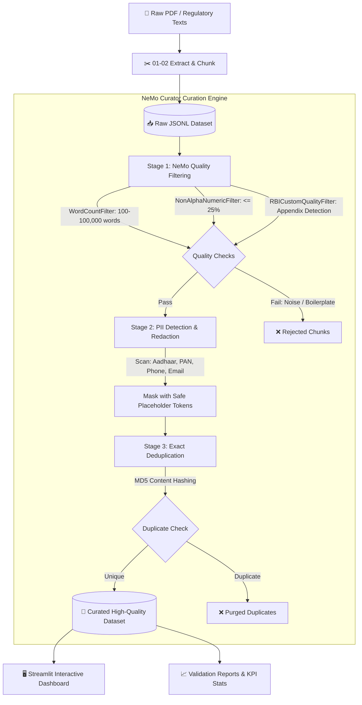

# 🛡️ NeMo Curator — Enterprise Dataset Quality & Insights Pipeline

<div align="center">

[](https://www.python.org/)
[](https://github.com/NVIDIA/NeMo-Curator)
[](https://streamlit.io/)
[](https://www.docker.com/)
[](#-regulatory-compliance--pii-filters)
[](https://opensource.org/licenses/MIT)

**An enterprise-grade, privacy-first dataset curation and auditing platform powered by NVIDIA NeMo Curator and Streamlit.**  
*Specialized showcase: End-to-end extraction, quality filtering, regulatory PII masking, and deduplication of RBI Master Direction — Know Your Customer (KYC) regulations.*

[Key Features](#-key-features) • [Pipeline Architecture](#-pipeline-architecture) • [PII & Compliance](#-regulatory-compliance--pii-filters) • [Quickstart](#-quickstart-guide) • [Interactive Dashboard](#-interactive-dashboard-features) • [Scripts Reference](#-standalone-pipeline-scripts)

</div>

---

## 📖 Overview

Training high-performance Large Language Models (LLMs) requires high-quality, sanitized data free of boilerplate noise, personal identifying information, and redundant tokens. 

This repository implements a production-ready dataset curation pipeline built with **NVIDIA NeMo Curator**. It includes both:
1. **Interactive Streamlit Web Dashboard**: Upload, audit, tune thresholds, and curate `.jsonl`/`.json` datasets in real time with visual analytics and before/after previews.
2. **Offline Automated ETL Pipeline**: A sequence of 9 deterministic Python scripts handling document extraction, chunking, quality heuristics, custom domain filtering, PII sanitization, deduplication, and automated reporting.

---

## 🌟 Key Features

- **🚀 NVIDIA NeMo Curator Pipeline**:
  - Leverages NeMo Curator's `Pipeline`, `ScoreFilter`, and `DocumentFilter` abstractions.
  - Sequential **Xenna Batch Execution** optimized for low-resource container environments (prevents out-of-memory overhead while retaining distributed architecture compatibility).
  - Built-in heuristic filters: `WordCountFilter` and `NonAlphaNumericFilter`.
  - Custom domain filter: `RBICustomQualityFilter` targeting legal disclaimers and repealed regulatory appendices.

- **🔒 Regulatory PII Redaction**:
  - High-precision regex detection conforming to Indian data privacy requirements: **Aadhaar**, **PAN**, **Indian Phone (+91)**, and **RFC 5322 Emails**.
  - Context-preserving token masking (`[AADHAAR]`, `[PAN]`, `[PHONE]`, `[EMAIL]`).
  - Granular audit trail tracking affected records, detection counts, and non-sensitive masked previews (`jo***n@domain.com`, `98******10`).

- **✂️ Exact & Semantic Deduplication**:
  - MD5 document hash fingerprinting to detect and purge verbatim record duplicates.
  - Detailed reporting of duplication ratios, cluster groupings, and unique records retained.

- **📊 Comprehensive Streamlit UI**:
  - Upload datasets on the fly with live stage toggles and interactive threshold sliders.
  - Real-time KPI metric cards (pass rate, PII detections, duplicate removal rate).
  - Side-by-side text difference viewer highlighting masked tokens.
  - One-click export for curated `.jsonl` datasets and JSON audit reports.

---

## 🏗️ Pipeline Architecture



---

## 🛡️ Regulatory Compliance & PII Filters

The PII masking engine is tailored for Indian regulatory and enterprise privacy standards:

| Identifier | Target Pattern | Masking Token | Compliance Mandate | Example Transformation |
|---|---|---|---|---|
| **Aadhaar** | `(?<!\d)\d{4}[-\s]?\d{4}[-\s]?\d{4}(?!\d)` | `[AADHAAR]` | Aadhaar Act 2016, Supreme Court Privacy Rulings, RBI KYC Ch. VI | `1234 5678 9012` → `[AADHAAR]` |
| **PAN Card** | `\b[A-Z]{5}[0-9]{4}[A-Z]\b` | `[PAN]` | Section 139A Income Tax Act 1961 & RBI Master Direction | `ABCDE1234F` → `[PAN]` |
| **Phone** | `(?<!\d)(?:\+91[-\s]?)?[6-9]\d{9}(?!\d)` | `[PHONE]` | Telecom Commercial Communications & DPDP Act 2023 | `+91-9876543210` → `[PHONE]` |
| **Email** | `\b[A-Za-z0-9._%+-]+@[A-Za-z0-9.-]+\.[A-Za-z]{2,}\b` | `[EMAIL]` | DPDP Act 2023 & RBI Customer Due Diligence (CDD) | `compliance@rbi.org.in` → `[EMAIL]` |

---

## 📈 Benchmark Results (RBI KYC Dataset)

Tested on the **Reserve Bank of India Master Direction — Know Your Customer (KYC)** regulatory corpus:

| Pipeline Stage | Input Records | Passed / Unique | Filtered / Masked | Efficiency / Pass Rate |
|---|---|---|---|---|
| **Quality Filtering** | 46 chunks | 45 records | 1 rejected (Appendix noise) | **97.83% pass rate** |
| **PII Redaction** | 45 records | 45 sanitized | 5 records with PII (6 emails masked) | **100% PII mitigated** |
| **Deduplication** | 50 records (5 stress duplicates) | 45 unique | 5 duplicates purged | **100% dedup accuracy** |
| **Final Curated Output** | 46 initial | **45 pristine records** | Ready for LLM Pre-training / Fine-tuning | **0 leaks, 0 redundant tokens** |

---

## 📁 Repository Structure

```
nemo-curator-project/
├── app/
│   ├── app.py                      # Streamlit interactive UI application
│   └── pipeline.py                 # NeMo Curator runtime processing engine & PII specs
├── dashboard/                      # Production reports & evaluation metrics
│   ├── final_project_report.json   # Aggregated pipeline execution stats
│   ├── quality_report.json         # Quality filtering breakdown
│   └── stats.json                  # Corpus metrics & vocabulary stats
├── data/
│   ├── raw/                        # Original RBI_KYC.pdf and kyc_raw.txt
│   ├── processed/                  # Intermediate JSONL datasets at each stage
│   └── final/                      # High-quality kyc_cleaned_dataset.jsonl
├── scripts/                        # Deterministic CLI ETL scripts
│   ├── 01_extract.py               # PDF text extraction using pypdf
│   ├── 02_chunk.py                 # Semantic chunking into structured JSONL
│   ├── 03_nemo_quality_filter.py   # NeMo Curator quality pipeline with Xenna
│   ├── 03_quality_report.py        # Generates quality filter summary
│   ├── 04_generate_dataset.py      # Prepares instruction/QA datasets
│   ├── 04_nemo_pii_masking.py      # NeMo Curator PII redaction stage
│   ├── 04_pii_masking.py           # Standalone PII regex runner
│   ├── 04_run_rbi_pii.py           # RBI-tailored PII masking pipeline
│   ├── 05_create_duplicates.py     # Injects intentional duplicate records for testing
│   ├── 05_deduplicate.py           # Exact dedup verification script
│   ├── 05_nemo_exact_dedup.py      # NeMo Curator exact deduplication stage
│   ├── 06_validate.py              # Quality & schema validation checks
│   ├── 07_stats.py                 # Dataset token & vocabulary statistics
│   ├── 08_final_report.py          # Builds consolidated final_project_report.json
│   └── 09_final_validation.py      # End-to-end dataset integrity assertion
├── pyrightconfig.json              # Language server configuration
├── requirements.txt                # Python project dependencies
├── .gitignore                      # Git exclusion rules for large datasets & venv
└── README.md                       # Repository documentation
```

---

## 🚀 Quickstart Guide

### Option A: Running with Docker (Recommended)

NeMo Curator requires a Linux environment for complete backend features (`XennaExecutor`). Running via Docker ensures zero environment mismatches:

```bash
# 1. Clone repository
git clone https://github.com/dishantcode01/nemo-curator.git
cd nemo-curator

# 2. Start container with workspace mounted
docker run -it -p 8501:8501 -v $(pwd):/workspace ubuntu:24.04 bash

# 3. Inside the container: install dependencies and launch
apt-get update && apt-get install -y python3 python3-pip python3-venv
python3 -m venv .venv
source .venv/bin/activate
pip install -r requirements.txt

# 4. Run Streamlit dashboard
streamlit run app/app.py --server.port 8501 --server.address 0.0.0.0
```

Access the UI at: **`http://localhost:8501`**

---

### Option B: Running Locally (macOS / Linux)

The runtime pipeline includes a resilient pure-Python fallback mode that runs on macOS even without NVIDIA GPU/CUDA drivers:

```bash
# 1. Clone repository
git clone https://github.com/dishantcode01/nemo-curator.git
cd nemo-curator

# 2. Create virtual environment
python3 -m venv .venv
source .venv/bin/activate

# 3. Install dependencies
pip install -r requirements.txt

# 4. Launch Streamlit
streamlit run app/app.py
```

---

## 🖥️ Standalone Pipeline Scripts

To execute the offline step-by-step pipeline manually on any raw document:

```bash
# Step 1: Extract raw text from PDF
python3 scripts/01_extract.py

# Step 2: Semantic chunking into JSONL
python3 scripts/02_chunk.py

# Step 3: Run NeMo Curator Quality Filtering
python3 scripts/03_nemo_quality_filter.py
python3 scripts/03_quality_report.py

# Step 4: Run PII detection and redaction
python3 scripts/04_run_rbi_pii.py

# Step 5: Test and apply exact deduplication
python3 scripts/05_create_duplicates.py
python3 scripts/05_nemo_exact_dedup.py

# Step 6: Validate output integrity and build final report
python3 scripts/06_validate.py
python3 scripts/07_stats.py
python3 scripts/08_final_report.py
python3 scripts/09_final_validation.py
```

---

## 💡 Interactive Dashboard Features

The Streamlit dashboard (`app/app.py`) provides:
1. **Interactive Curation Studio**:
   - Upload any custom `.jsonl` or `.json` file or use pre-loaded sample datasets.
   - Adjust minimum word count, maximum non-alphanumeric ratio, and custom filter indicators.
   - Selectively enable or disable individual PII rules (Aadhaar, PAN, Phone, Email).
2. **Real-time Pipeline Telemetry**:
   - Stage progression metrics: Pass/fail counts, retention rates, duplicate counts.
   - PII distribution breakdowns and detection instance counters.
3. **Audit & Inspection**:
   - Interactive document tables with search and column sorting.
   - Diff preview highlighting exact masked entities and replaced tokens.
4. **Data Export**:
   - Download the clean curated dataset (`.jsonl`) with preserved metadata IDs.
   - Download the comprehensive audit log (`.json`) for compliance records.

---

## 📜 License

This project is licensed under the [MIT License](LICENSE).
